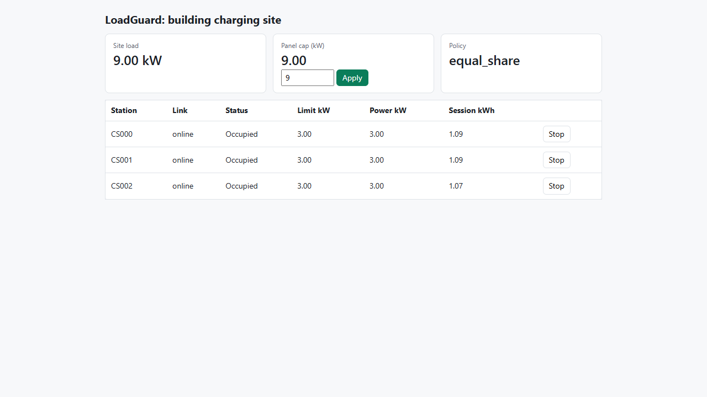
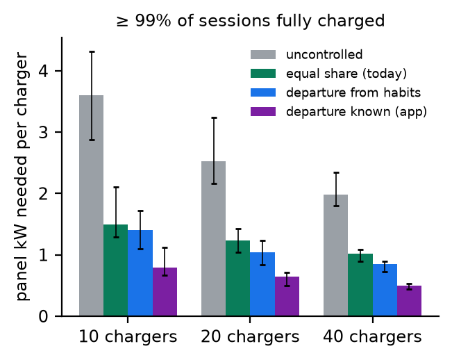

# LoadGuard: an OCPP 2.0.1 test lab, and what load management is worth

[](https://github.com/mouadhassal/loadguard/actions/workflows/ci.yml)

**Report:** [paper/loadguard_report.pdf](paper/loadguard_report.pdf) (4 pages) · **Test strategy:** [TEST_STRATEGY.md](TEST_STRATEGY.md)

Dynamic load management lets a multifamily building put many EV chargers on a panel sized for a few. This repo answers the two questions that decide whether it works:

1. **Is it safe and correct?** An automated test lab: a reference OCPP 2.0.1 CSMS, a fleet of simulated chargers with physics and fault injection, and a test suite that is itself mutation-tested.
2. **What is it worth?** A pre-registered replay of real apartment-garage charging sessions, run through the *same* allocation code the lab tests.

## 1. The test lab

```
pytest            # 31 tests: protocol, safety, resilience, billing, properties, mutants, Playwright UI
```

| Area | Tests | Examples |
|---|---|---|
| Protocol (OCPP 2.0.1 use cases) | 6 | B01 boot, C01 blocked token, E seqNo continuity, K01 profile targeting, CALLERROR on garbage, F01/F03 remote start/stop via REST |
| Safety | 6 | panel never exceeded on arrivals, in steady state or **during a CSMS outage**; billing = meter under retransmissions and dropouts |
| Load management | 6 | max-min fair shares, work conservation, demand-response curtailment < 1 s, departure-aware priority |
| Resilience | 2 | CSMS crash and restart resumes sessions from SQLite; offline events replayed in order |
| Property-based (Hypothesis) | 4 | 2,000 random sites each: cap, fairness, work conservation, EDF order |
| Browser E2E (Playwright) | 2 | operator starts and stops a session; lowering the cap curtails the site |
| **Mutation tests** | 5 | every safety check must *fail* on a deliberately broken controller |

**Mutants killed: 5 of 5, each for the right reason.**

| Mutant | Flaw | Caught with |
|---|---|---|
| M1 | factory-default charging limit | 37.6 kW drawn from a 16 kW panel during a cloud outage |
| M2 | limit increases sent before decreases | 14 transient overloads, peak 20 kW |
| M3 | billing without de-duplication | customer billed 2.20 kWh for 1.10 kWh |
| M4 | allocator ignores the cap | 36 kW sustained on a 16 kW panel |
| M5 | ignores `SuspendedEV` | 4 of 12 kW stranded on a full car |

**Real defects the lab found in my own CSMS, now fixed and guarded:**

1. **Rounding up.** Limits rounded to nearest put 16.0002 kW on a 16 kW panel.
2. **Stranded capacity.** A full car kept its share until it was unplugged.
3. **Quadratic command fan-out.** The load test sent 29,700 commands for 200 arrivals. Whole-amp limits cut commands 5.2× and settling time 3.9×, with **zero panel overloads in every load-test run**.



## 2. What load management is worth (pre-registered)

**Data.** SINTEF's apartment-building sessions (Trondheim, CC BY 4.0, [data/README.md](data/README.md)).

**Setup.** Buildings of 10, 20 and 40 residents drawn at random, 100 each. Every session is replayed on its real date. The goal: at least 99% of sessions fully charged.

**Freeze.** Hypotheses were frozen in [PREREGISTRATION.md](PREREGISTRATION.md) (SHA-256 `16706db2…`) before the test window (Oct 2019 – Jan 2020: 56 residents, 3,583 sessions) was run. **All four passed.**

| Panel needed (40 chargers) | kW | vs uncontrolled |
|---|---|---|
| uncontrolled | 79.2 | 1.00 |
| equal share (today's standard) | 40.6 | 0.49 |
| departure learned from habits | 33.7 | 0.40 (0.83× equal share, CI 0.81–0.84) |
| **departure known (app asks "when do you leave?")** | **19.7** | **0.24** |

- **Demand charges:** at Toronto Hydro's 2026 general-service rate ($17.84 per kW per 30 days), the EV peak reduction is worth **$139–259 per charger per year**. That is an upper bound on its contribution to the building's coincident peak.
- **Chargers per panel:** a 36 kW panel carries **10 chargers uncontrolled, about 34 with equal sharing, and 40+ with departure-aware control** (exploratory).



## Run it

```
python -m venv .venv
.venv/Scripts/pip install -r requirements.txt
pytest                                  # uses installed Edge for Playwright; CI uses Chromium
python -m loadguard.csms                # (from src/) CSMS on ws://127.0.0.1:9000, dashboard on :8080
python bench/load_test.py 50 100 200    # load test -> results/load.json
python study_run.py test                # pre-registered study -> results/study_test.json
python analyze.py                       # verdicts -> results/verdicts.json
python figures.py ; python paper/build_pdf.py
```

## Layout

```
src/loadguard/
  alloc.py     allocation policies, shared by the CSMS and the study (uncontrolled, equal_share, edf)
  csms.py      reference OCPP 2.0.1 CSMS: smart charging, SQLite state, REST API, dashboard; mutant switches
  sim.py       simulated charging stations: physics, offline queue, fault injection, panel meter
  study.py     exact event-driven replay of real sessions; capacity search; 15-min demand peaks
tests/         the suite (checks.py holds the safety properties shared with test_mutants.py)
bench/         load test
study_run.py   pre-registered study; analyze.py verdicts; figures.py
```

## Honest notes

- **Reference system.** The CSMS is my reference implementation, not a production system; simulated chargers obey limits instantly. The harness only needs a WebSocket URL, so it can be pointed at any OCPP 2.0.1 CSMS. I did not run it against CitrineOS, because Docker was unavailable on the build machine.
- **Data.** The sessions are Norwegian (cold climate, long overnight stays), and every charger is assumed to be 7.2 kW.

Author: Mouadh Abderrahmane Assal, thereviewboost@gmail.com
