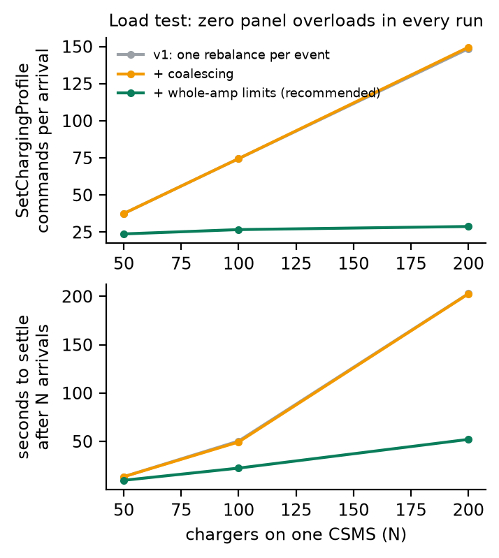
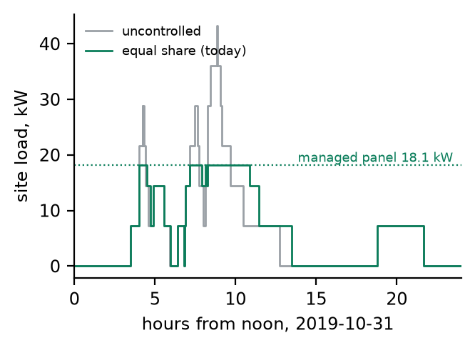

# LoadGuard: Testing and Valuing Dynamic Load Management for Multifamily EV Charging

<div class="authors">Mouadh Abderrahmane Assal</div>
<div class="affil">thereviewboost@gmail.com · github.com/mouadhassal/loadguard</div>

<div class="abstract" markdown="1">

## Abstract

Dynamic load management lets a multifamily building put many EV chargers on a panel sized for a few. It is only worth selling if two things hold: it is **safe and correct**, and it is **worth money**. I address both with one codebase.

**Safe and correct.** An OCPP 2.0.1 test lab pairs a reference charging-station management system (CSMS) with a fleet of simulated chargers. The simulator models physics, offline queues and fault injection. A meter checks the physical panel on every power change. The 31-test suite covers protocol, safety, resilience, billing, property-based and browser tests. It is **mutation-tested**: all 5 deliberately broken controllers are caught, each for the right reason; one of them drew 37.6 kW from a 16 kW panel during a cloud outage. The suite found three real defects in my own CSMS. A load test showed quadratic command fan-out; whole-amp limits cut commands 5.2× and settling time 3.9× at 200 chargers, with zero overloads.

**Worth money.** A **pre-registered** replay of 3,583 real apartment-garage sessions over 300 random buildings, with all four hypotheses passed, gives these panel sizes for a 40-charger building that fully charges at least 99% of sessions:

- 79 kW with no management;
- 41 kW with today's equal sharing;
- 34 kW when departure times are learned from residents' habits;
- **20 kW** when the app asks residents when they leave.

The demand-charge value at Toronto Hydro's 2026 general-service rate is &#36;139–259 per charger per year.

</div>

<div class="keywords">OCPP 2.0.1 · smart charging · test automation · mutation testing · multifamily EV charging · pre-registration</div>

<hr class="rule">

<div class="cols" markdown="1">

## 1. Why both questions at once

A multifamily retrofit usually has a fixed amount of spare electrical capacity. Load management shares that capacity among chargers in real time. That is the core of products like SWTCH Control, which promise many more chargers without a service upgrade.

Two failure modes decide whether the promise holds:

- **The controller misbehaves.** It overloads the panel during a cloud outage, double-bills a retransmitted message, or strands capacity on a full car.
- **The value is oversold**, because nobody measured it on real arrival patterns.

This report treats them together. The allocation code the lab tests (`loadguard.alloc`) is the *same* code the study values.

## 2. The test lab

### 2.1 System under test

The reference CSMS speaks OCPP 2.0.1 over WebSocket, using the open-source `ocpp` library with JSON-schema validation on every message. It handles boot, authorisation, transaction events, meter values, remote start/stop and smart charging. Each charger's limit is pushed as a `TxProfile`; idle chargers receive a `TxDefaultProfile`. State persists in SQLite, so a restart keeps transactions and billing. A REST API and an operator dashboard sit on top.

Its safety-relevant design choices are switches, which is what makes mutation testing possible:

- **Default limit for idle chargers.** "Headroom" gives each idle charger its share of unallocated capacity. "Static max" leaves it at the charger maximum.
- **Update order.** Decreases are sent and confirmed before increases, or the reverse.
- **Billing.** Bill from the cumulative register with de-duplication on (transactionId, seqNo), or sum per-event interval energy.
- **Work conservation.** Whether to react to `SuspendedEV`.

### 2.2 Simulator and the physical meter

Each simulated charger is a real OCPP client. Energy integrates power on an accelerated clock. Transaction messages are queued with `offline=true` while the link is down and replayed in order afterwards. Faults can be injected: network drops, retransmitted events, reboots and CSMS crashes.

The fleet's meter checks the physical site load against the panel rating **on every power change**, not by sampling, so a millisecond overload during a reallocation is caught.

### 2.3 The suite

| Area | Tests | What they assert |
|---|---|---|
| Protocol (B01, C01, E, F01/F03, K01) | 6 | boot, blocked tokens, contiguous seqNo, profile targeting, CALLERROR on malformed input, remote start/stop via REST |
| Safety | 6 | no overload on arrivals or in steady state; safe during a CSMS outage; billing equals meter under retransmissions and dropouts |
| Load management | 6 | max-min fair shares, work conservation, demand-response curtailment in < 1 s, EDF priority |
| Resilience | 2 | CSMS crash and restart resumes sessions and bills correctly; offline replay in order |
| Properties (Hypothesis) | 4 | cap and charger limits, work conservation, max-min fairness, EDF order (2,000 random sites each) |
| Browser (Playwright) | 2 | the operator starts and stops a session; lowering the cap curtails the site |
| Mutants | 5 | every safety check fails on a broken controller |

All 31 tests pass, and CI runs them on every push.

### 2.4 Mutation testing: do the tests catch bad controllers?

| Mutant | What is broken | Killed by | Evidence |
|---|---|---|---|
| M1 | factory-default `TxDefaultProfile` | outage test | 37.6 kW on a 16 kW panel |
| M2 | increases sent before decreases | arrivals test | 14 transient overloads, peak 20 kW |
| M3 | billing sums interval energy without dedupe | retransmission test | billed 2.20 kWh for 1.10 kWh delivered |
| M4 | allocator ignores the cap | steady-state test | 36 kW sustained |
| M5 | ignores `SuspendedEV` | work-conservation test | 4 of 12 kW stranded |

Each kill must also contain the expected failure reason. A check that cannot fail on a known-bad controller is not a test.

### 2.5 What the lab found in its own CSMS

1. **Rounding.** Limits were rounded to the nearest 0.1 W, so 6 × 2,666.7 W = 16.0002 kW on a 16 kW panel. They are now rounded down; real chargers take integer amps, and the same rule applies there.
2. **Stranded capacity.** A full car kept its share until it was unplugged. The fix: chargers report `ChargingStateChanged → SuspendedEV`, and the CSMS reallocates. This defect is now mutant M5.
3. **Quadratic fan-out** (Sec. 3).

<div class="fig" markdown="1">

<p class="caption"><b>Figure 1.</b> The operator dashboard, captured by the Playwright test right after the cap was lowered to 9 kW: three chargers at exactly 3.00 kW.</p>
</div>

## 3. Load test

N chargers connect to one CSMS process, and cars arrive every 50 ms. With equal sharing, every arrival changes everyone's share, so v1 sent about 0.75·N commands per arrival: **29,700 commands and 203 s to settle** for 200 arrivals.

Coalescing queued rebalances helped boot (p95 5.2 → 3.1 s) but not arrivals, which never actually piled up. Quantising limits to whole amps (0.24 kW at 240 V), still rounded down, kept the per-arrival fan-out nearly flat in N: 23.8, 26.7 and 28.8 at N = 50, 100, 200. That cut commands **5.2×** and settling time **3.9×** at N = 200. **No run overloaded the panel.**

<div class="fig" markdown="1">

<p class="caption"><b>Figure 2.</b> Commands per arrival and time to settle against fleet size. Whole-amp limits make fan-out nearly independent of N.</p>
</div>

## 4. What is it worth? A pre-registered study

### 4.1 Data and method

**Data.** SINTEF's apartment-building dataset [1] (CC BY 4.0) holds plug-in, plug-out and kWh for residents' private chargers in Trondheim garages. Each session needs min(kWh, 7.2 kW × stay).

**Buildings.** A building is K residents drawn at random, each with a 7.2 kW charger, with every session replayed **on its real date**, so coincidences are genuine. There are 100 buildings per K ∈ {10, 20, 40}.

**Simulation.** An exact event-driven simulator runs four policies through the same `alloc` functions as the CSMS:

- **uncontrolled:** every car at full power;
- **equal share:** max-min fair, without departure information;
- **EDF-habit:** earliest departure first, with each departure estimated causally from the resident's own earlier sessions;
- **EDF-true:** the departure is known, as when the app asks.

**Capacity needed.** C\* is the smallest panel at which ≥ 99% of sessions are fully charged.

**Protocol.** Hypotheses and thresholds were frozen (SHA-256 `16706db2…`) after a development window (Jan–Sep 2019) and before the test window (Oct 2019 – Jan 2020: 56 residents, 3,583 sessions).

### 4.2 Results: all four hypotheses passed

| | K = 10 | K = 20 | K = 40 | rule |
|---|---|---|---|---|
| **S1** C\*(equal) / C\*(uncontrolled) | 0.46 | 0.47 | 0.49 | ≤ 0.55 ✓ |
| **S2** C\*(habit) / C\*(equal) | 0.90 | **0.85** [0.82, 0.87] | **0.83** [0.81, 0.84] | CI < 1 at 20, 40 ✓ |
| **S3** C\*(true) / C\*(equal) | 0.52 | 0.51 | 0.49 | ≤ 0.75 ✓ |
| **S4** &#36;/charger/yr (GS) | 259 | 192 | **139** | ≥ 60 at 40 ✓ |

**Panel needed for 40 chargers** (median):

| Policy | Panel | Per charger |
|---|---|---|
| uncontrolled | 79.2 kW | 1.98 kW |
| equal share | 40.6 kW | 1.01 kW |
| EDF-habit | 33.7 kW | 0.84 kW |
| EDF-true | **19.7 kW** | 0.49 kW |

Read the other way (exploratory, interpolated): a 36 kW panel (100 A, 208 V three-phase) carries **10** chargers uncontrolled, **about 34** with equal sharing, and **at least 40** with departure-aware control.

<div class="fig" markdown="1">

<p class="caption"><b>Figure 3.</b> Panel kW needed per charger (median, 10th–90th percentile over 100 buildings) so that ≥ 99% of sessions are fully charged.</p>
</div>

<div class="fig" markdown="1">

<p class="caption"><b>Figure 4.</b> One real evening in a 20-charger building. Uncontrolled charging peaks at 43 kW; equal sharing holds 18.1 kW and still fully charges ≥ 99% of the window's sessions.</p>
</div>

**Dollars.** The Toronto Hydro General Service 50–999 kW delivery rate (1 Jan 2026) is &#36;10.517/kVA + &#36;2.894/kW + &#36;4.431/kW = **&#36;17.84 per kW per 30 days**. Lowering the EV load's monthly 15-minute peak from 66.3 to 40.6 kW in a 40-charger building is worth **&#36;139 per charger per year**: &#36;5,560 a year for the building. On the EV-charging (EVC) transmission rates it is worth &#36;92. This counts the EV load's own peak, so it is an upper bound on its contribution to the building's coincident peak.

## 5. What this means for the product

1. **Ask residents when they leave.** Knowing departure times halves the panel that equal sharing needs (0.49–0.52×) at the same service level. Learning habits alone recovers 15–17%. This is a one-field change in the driver app.
2. **Reallocate on charging state.** Without it, full cars strand capacity.
3. **Command in whole amps, decreases first, headroom for idle chargers.** The lab shows that these three rules keep the panel safe through outages and transients, and that the quantisation makes the cloud scale.
4. **Make safety a CI gate.** Panel-rating and billing invariants, proven by mutants, should block a merge.

## 6. Limitations

- **The data is Norwegian.** It comes from a cold climate with long overnight stays, and may not match Ontario patterns exactly. Every charger is assumed to be 7.2 kW.
- **The dollars are an upper bound.** They value the EV load's own peak, not the building's coincident peak.
- **It is a simulation.** The CSMS is a reference implementation, not SWTCH's. Simulated chargers obey limits instantly, and there is no hardware in the loop. An open-source CSMS such as CitrineOS was not tested, because Docker was unavailable on the build machine; the harness only needs a WebSocket URL.
- **The service level is fixed.** It is 99% of sessions fully charged; other targets shift C\*.

## 7. Reproducibility

```
pytest            # 31 tests
python bench/load_test.py 50 100 200
python study_run.py test
python analyze.py ; python figures.py
```

## References

<div class="refs" markdown="1">

[1] Å. L. Sørensen, K. B. Lindberg, I. Sartori, I. Andresen, Residential electric vehicle charging datasets from apartment buildings, *Data in Brief* **36**, 107105 (2021); data doi:10.17632/jbks2rcwyj.2.

[2] Open Charge Alliance, *OCPP 2.0.1 Specification*, Parts 1–4 (2020, with errata).

[3] Toronto Hydro-Electric System Ltd., Business rates and charges, effective 1 January 2026, torontohydro.com.

[4] R. A. DeMillo, R. J. Lipton, F. G. Sayward, Hints on test data selection: help for the practicing programmer, *IEEE Computer* **11**(4), 34–41 (1978).

[5] C. L. Liu, J. W. Layland, Scheduling algorithms for multiprogramming in a hard-real-time environment, *J. ACM* **20**, 46–61 (1973).

[6] D. Bertsekas, R. Gallager, *Data Networks*, 2nd ed., Prentice Hall (1992), Sec. 6.5 (max-min fairness).

[7] The Mobility House, `ocpp`: Python implementation of OCPP 1.6/2.0.1/2.1, github.com/mobilityhouse/ocpp.

[8] D. R. MacIver et al., Hypothesis: a new approach to property-based testing, *JOSS* **4**(43), 1891 (2019).

</div>

</div>
